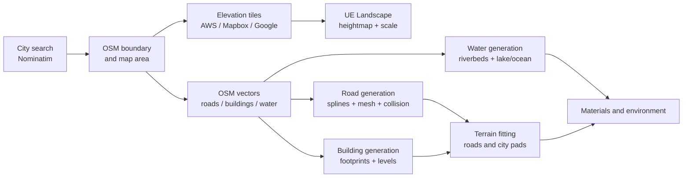

# GeoLandscape

[English](README.en.md) | [Русский](README.md)

**Private Unreal Engine 5 plugin for generating playable landscapes and cities from real geodata.**

> Source code is private. This repository is a public showcase: screenshots, workflow, architecture notes and feature overview without plugin sources, API keys or internal project files.

## Preview

Playable generated scene:

Editor window preview:

## Gallery

| Generation map and settings | Landscape and water |
|---|---|
|  |  |

| Generated city layout | Editable generated actor |
|---|---|
|  |  |

## What It Does

GeoLandscape is an Unreal Engine 5 editor plugin that generates a scene from real-world geodata:

- landscape from real elevation/heightmap data;
- city search and boundaries through OpenStreetMap data;
- roads, road profiles, intersections, shoulders, curbs and markings;
- buildings from OSM footprints and height/level tags;
- rivers, canals, lakes and ocean zones;
- terrain fitting under roads and generated city areas;
- automatic landscape materials for waterbed, beach, grass, cliffs and snow;
- scene environment: sun/moon, sky atmosphere, skylight, fog and post process.

## Workflow

1. Open `Window -> GeoLandscape` in Unreal Editor.
2. Search a city through Nominatim.
3. Select the area on the OSM map.
4. Choose zoom, quality and generation limits.
5. Generate terrain, roads, buildings, water and environment as separate pipeline stages.
6. Edit generated actors manually and regenerate while preserving selected changes.

## Feature Overview

| Area | Implemented functionality |
|---|---|
| Editor UI | `Window -> GeoLandscape`, city search, map selection, zoom/quality settings, generation stages |
| Terrain | AWS Terrarium, Mapbox Terrain-RGB, Google Elevation API, real-world scale, bathymetry |
| Landscape | valid UE landscape size selection, collision rebuild, Nanite/HLOD-oriented settings |
| OSM pipeline | Overpass loading by chunks, city clipping, deduplication, partial API error handling |
| Roads | OSM `highway` profiles, spline editing, mesh/collision, intersections, shoulders, curbs, markings |
| Buildings | OSM footprints, `height`, `building:levels`, editable actors, batch/sector generation |
| Water | `waterway`, `natural=water`, riverbed cutting, lake/ocean actors through UE Water plugin |
| Materials | waterbed, beach, grass, cliffs/slopes, snow, shoreline blend, normal/roughness tuning |
| Environment | sun/moon, sky atmosphere, skylight, height fog, post process presets |

## Technical Highlights

- C++ editor plugin split into runtime and editor modules.
- Slate-based editor window and map picker.
- Heightmap conversion from tile data into Unreal landscape coordinates.
- OSM vector parsing for roads, buildings and water objects.
- Generated road actors and sector actors for large city performance.
- Editable generated building actors with metadata from OSM.
- Regeneration flow that preserves manual edits/deletions where possible.
- VRAM-conscious modes for large cities and batch generation.

## Media

Current media included in this showcase:

| File | What to show |
|---|---|
| `docs/images/01-playable-city-view.png` | Playable view with landscape, grass, generated city and character scale |
| `docs/images/02-editor-window.png` | GeoLandscape editor window with city search and generation settings |
| `docs/images/03-generation-map-settings.png` | OSM map, selected region, generation settings and progress log |
| `docs/images/04-landscape-water-overview.png` | Generated island/coast landscape and water |
| `docs/images/05-city-layout-buildings.png` | Large generated city layout from OSM buildings |
| `docs/images/06-editable-building-actor.png` | Individual generated building selected and editable in Unreal |

Recommended media still worth adding:

- close-up of roads/intersections/curbs;
- close-up of riverbeds and shoreline;
- 30-90 second workflow video: city search -> generation -> generated scene.

See [docs/MEDIA_GUIDE.md](docs/MEDIA_GUIDE.md) for capture instructions.

## Repository Scope

This showcase intentionally does not include:

- source code;
- Unreal `.uasset` files;
- API keys and provider tokens;
- local cache files;
- generated build artifacts;
- private logs and machine-specific paths.

It is safe to publish:

- screenshots and short videos;
- high-level architecture;
- feature descriptions;
- technical decisions;
- known limitations and roadmap.

## More Details

- [Case study](docs/CASE_STUDY.md)
- [Media guide](docs/MEDIA_GUIDE.md)
- [Publishing checklist](docs/PUBLISHING.md)
