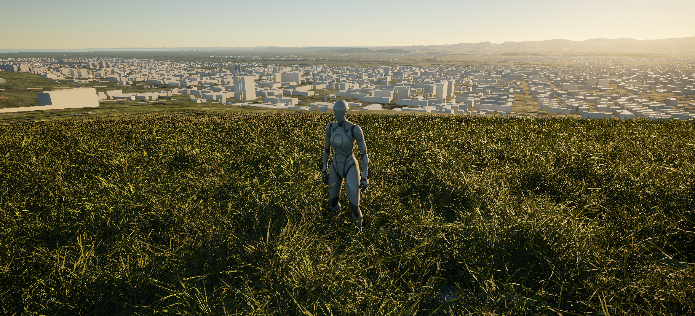
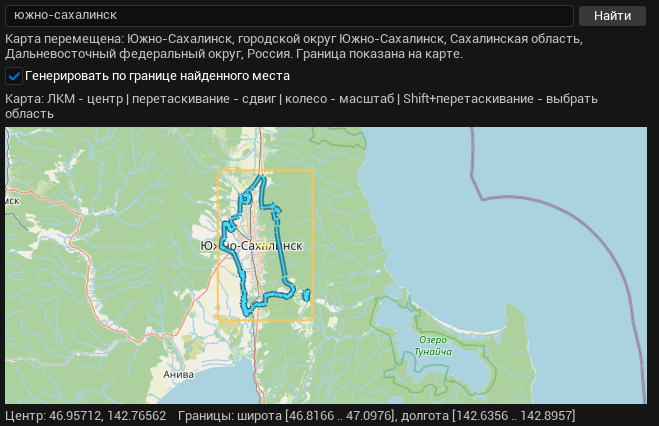
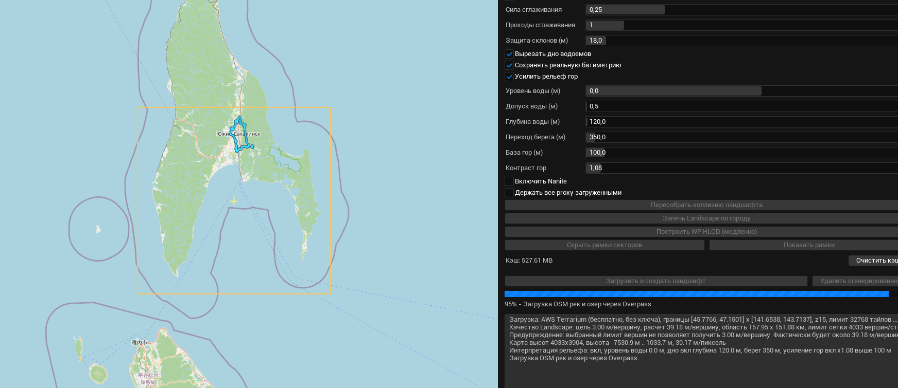
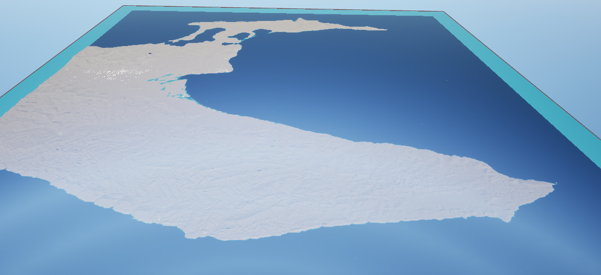
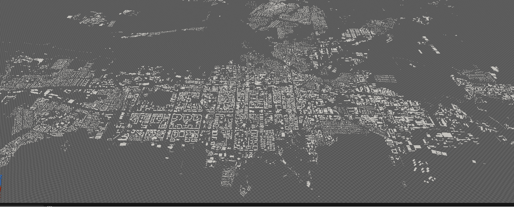
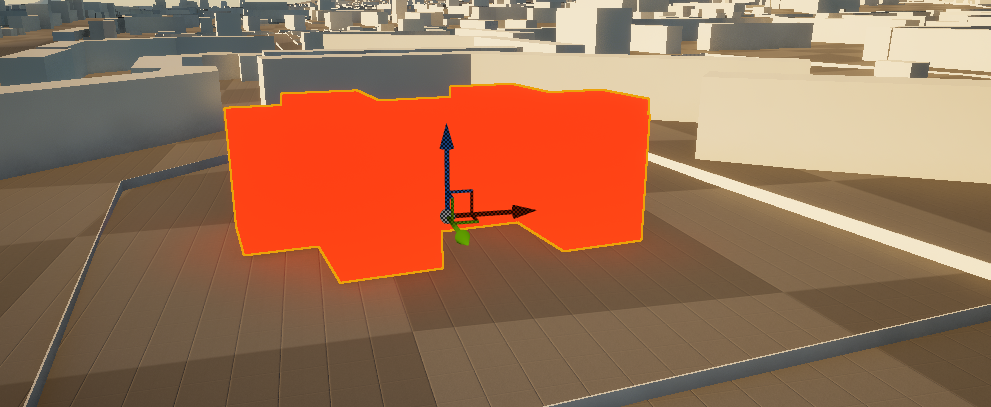
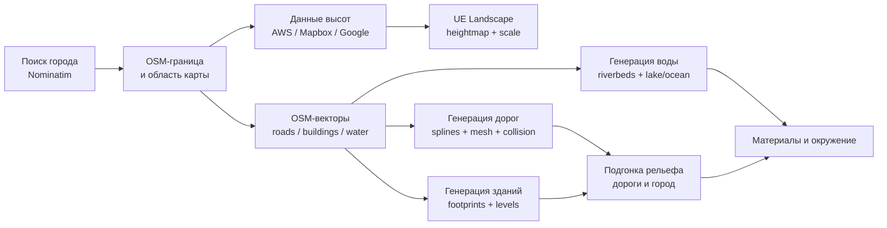

# GeoLandscape

[Русский](README.md) | [English](README.en.md)

**Приватный плагин для Unreal Engine 5, который генерирует игровые ландшафты и города по реальным геоданным.**

> Исходный код приватный. Этот репозиторий - публичная витрина проекта: скриншоты, описание workflow, архитектура и обзор возможностей без исходников плагина, API-ключей и внутренних файлов проекта.

## Превью

Игровой вид с уже сгенерированной сценой:

Окно плагина в редакторе:

## Галерея

| Карта генерации и настройки | Ландшафт и вода |
|---|---|
|  |  |

| Сгенерированный город | Редактируемый актор |
|---|---|
|  |  |

## Что Делает Плагин

GeoLandscape - это editor-плагин для Unreal Engine 5, который создает сцену на основе реальных геоданных:

- ландшафт по реальным данным высот;
- поиск города и границ через OpenStreetMap;
- дороги, профили дорог, перекрестки, обочины, бордюры и разметку;
- здания по OSM footprints и тегам высоты/этажности;
- реки, каналы, озера и океанские зоны;
- подгонку рельефа под дороги и городскую застройку;
- автоматические материалы ландшафта для дна, пляжа, травы, скал и снега;
- окружение сцены: солнце/луна, sky atmosphere, skylight, fog и post process.

## Как Работает

1. Открыть `Window -> GeoLandscape` в Unreal Editor.
2. Найти город через Nominatim.
3. Выбрать область на OSM-карте.
4. Настроить zoom, качество и лимиты генерации.
5. Запустить отдельные этапы: terrain, roads, buildings, water и environment.
6. Отредактировать сгенерированные акторы вручную и при необходимости перегенерировать сцену с сохранением выбранных правок.

## Возможности

| Область | Что реализовано |
|---|---|
| Editor UI | `Window -> GeoLandscape`, поиск города, выбор области на карте, настройки zoom/качества, отдельные этапы генерации |
| Terrain | AWS Terrarium, Mapbox Terrain-RGB, Google Elevation API, реальный масштаб, батиметрия |
| Landscape | подбор валидного размера UE landscape, пересборка collision, настройки под Nanite/HLOD |
| OSM pipeline | загрузка через Overpass чанками, clipping по границе города, дедупликация, обработка частичных ошибок API |
| Дороги | профили по OSM `highway`, spline editing, mesh/collision, перекрестки, обочины, бордюры, разметка |
| Здания | OSM footprints, `height`, `building:levels`, редактируемые акторы, batch/sector generation |
| Вода | `waterway`, `natural=water`, вырезание русел, lake/ocean actors через UE Water plugin |
| Материалы | дно, пляж, трава, скалы/уклоны, снег, shoreline blend, normal/roughness-настройки |
| Окружение | солнце/луна, sky atmosphere, skylight, height fog, post process presets |

## Технические Детали

- C++ editor-плагин, разделенный на runtime и editor модули.
- Интерфейс редактора на Slate.
- Конвертация heightmap/tile данных в координаты Unreal Landscape.
- Парсинг OSM-векторов для дорог, зданий и водных объектов.
- Road actors и sector actors для больших городов.
- Редактируемые building actors с OSM metadata.
- Перегенерация с сохранением части ручных правок и удалений.
- VRAM-conscious режимы и batch generation для крупных городов.

## Медиа

В витрине уже есть:

| Файл | Что показывает |
|---|---|
| `docs/images/01-playable-city-view.png` | Игровой вид: ландшафт, трава, город и масштаб относительно персонажа |
| `docs/images/02-editor-window.png` | Окно GeoLandscape с поиском города и настройками генерации |
| `docs/images/03-generation-map-settings.png` | OSM-карта, выбранная область, настройки и лог генерации |
| `docs/images/04-landscape-water-overview.png` | Сгенерированный островной/прибрежный ландшафт и вода |
| `docs/images/05-city-layout-buildings.png` | Большой городской layout по OSM-зданиям |
| `docs/images/06-editable-building-actor.png` | Отдельное сгенерированное здание выбрано и редактируется в Unreal |

Что еще стоит добавить:

- крупный план дорог, перекрестков и бордюров;
- крупный план рек, воды и береговой линии;
- короткое видео 30-90 секунд: поиск города -> генерация -> готовая сцена.

Инструкция по подготовке медиа: [docs/MEDIA_GUIDE.md](docs/MEDIA_GUIDE.md).

## Состав Репозитория

Витрина специально не содержит:

- исходный код;
- Unreal `.uasset` файлы;
- API-ключи и токены провайдеров;
- локальные cache-файлы;
- build-артефакты;
- приватные логи и machine-specific пути.

Публиковать безопасно:

- скриншоты и короткие видео;
- высокоуровневую архитектуру;
- описание возможностей;
- технические решения;
- ограничения и roadmap.

## Дополнительно

- [Case study](docs/CASE_STUDY.md)
- [Media guide](docs/MEDIA_GUIDE.md)
- [Publishing checklist](docs/PUBLISHING.md)
