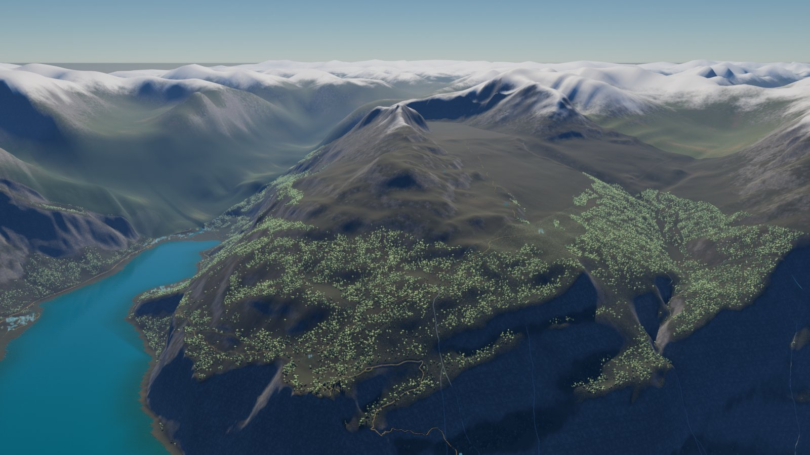
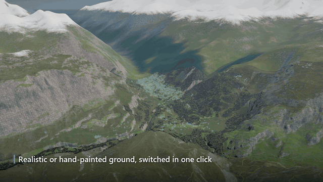
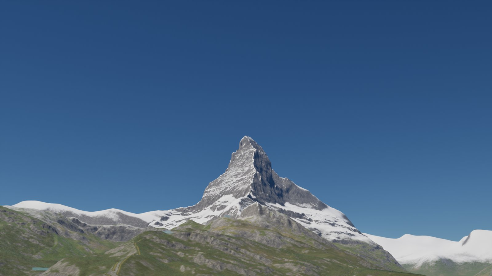
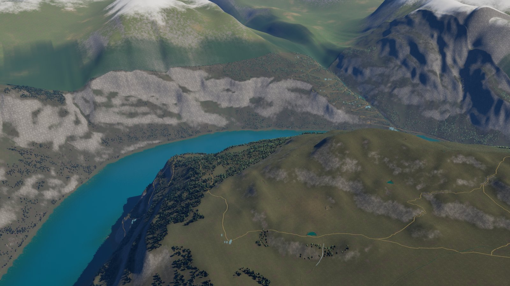
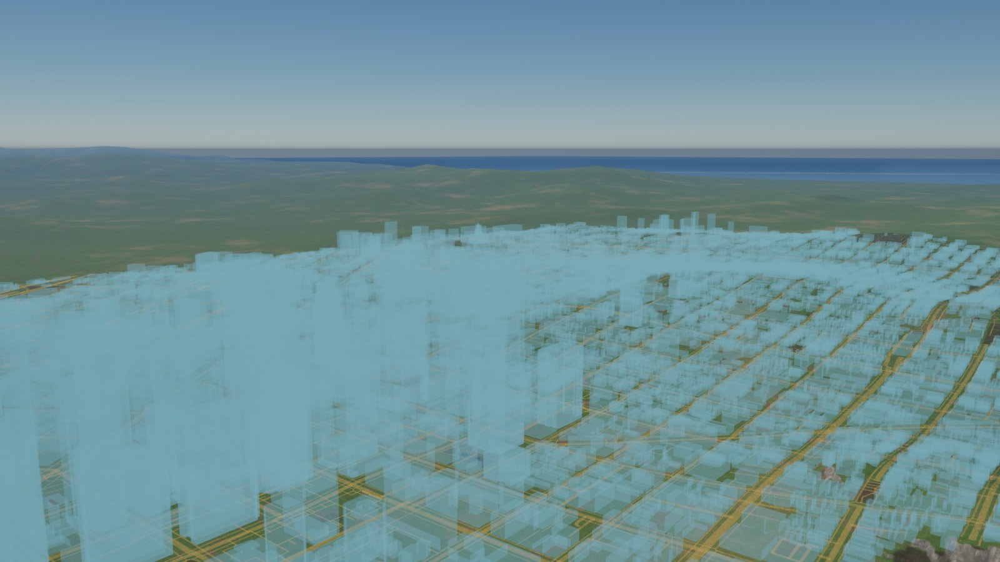
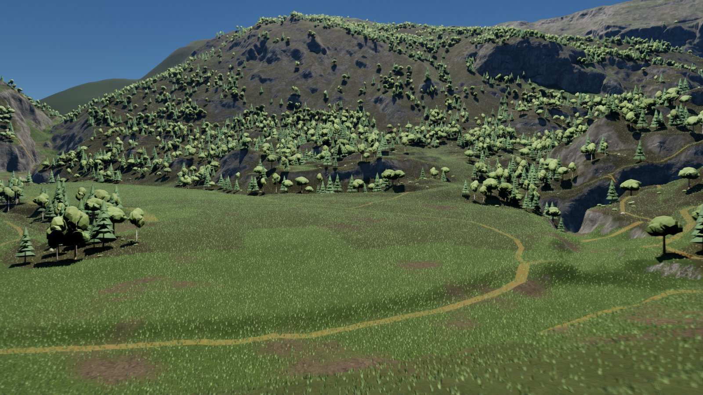
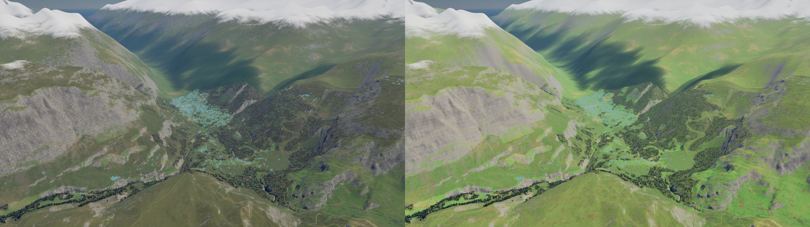
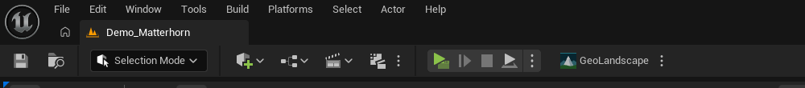
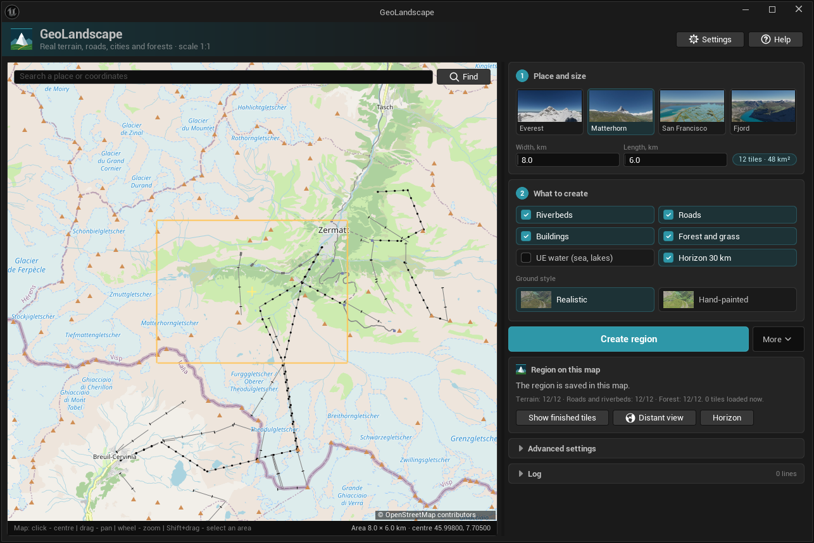
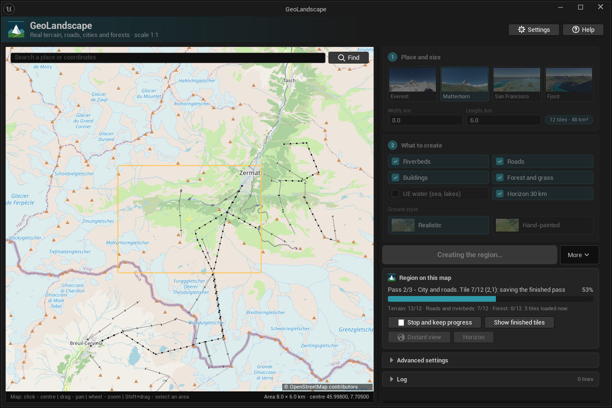

# GeoLandscape для Unreal Engine 5

[English](README.md) | [Русский](README.ru.md)

**Любое место на Земле — уровень World Partition с подгрузкой.** Выберите область на карте,
нажмите **«Создать регион»**, и GeoLandscape построит реальный рельеф в масштабе 1:1 с
дорогами OpenStreetMap, разметкой города, реками, лесами PCG, травой, дальним видом для игры
и горизонтом на 30 км — прямо в редакторе Unreal.

- **Где взять:** на Fab (ссылка появится здесь после публикации).
- **Руководство:** [Русский](docs/Manual.ru.md) · [English](docs/Manual.md)
- **Помощь и сообщения об ошибках:** [GitHub Issues](https://github.com/evG10/geolandscape-showcase/issues)

Здесь лежат документация, скриншоты и поддержка плагина. Исходный код плагина закрыт.

## Что умеет

- **Рельеф** по открытым данным высот: Copernicus GLO-30 по всему миру, USGS 3DEP (США,
  1–10 м), swissALTI3D (Швейцария, 2 м), Terrarium или ваш GeoTIFF. Диапазон высот
  подбирается для каждого региона, поэтому помещаются и Эверест, и Мёртвое море.
- **Дороги** из OpenStreetMap, уложенные по рельефу, с выравниванием земли под ними; мосты и
  тоннели сохраняют свою высоту.
- **Разметка города** по реальным контурам и высотам зданий: полупрозрачный макет города и
  дорог, по которому строят свои здания.
- **Реки и озёра**, вырезанные в рельефе, и по желанию океаны, озёра и реки UE Water, с
  пенными каскадами на крутых перепадах.
- **Леса PCG** рощами и полянами с подлеском, редактируемые наборы растительности и трава на
  ландшафте. Низкополигональные деревья, кусты, трава и камни входят в комплект.
- **Материал земли** без ручной раскраски: трава, почва, лесная подстилка, скалы, песок, снег
  и морское дно по уклону, высоте и береговой линии; реалистичный или рисованный, переключение
  одним щелчком.
- **Дальний вид (HLOD)** для городов, дорог, лесов и рельефа и **горизонт на 30 км** вокруг
  региона.
- **Большие регионы** участками 2 × 2 км с подгрузкой в три этапа. Готовые этапы сохраняются,
  поэтому регион можно остановить, продолжить и расширить позже.
- Интерфейс редактора на **русском и английском**. Демо-уровни: Эверест, Маттерхорн и
  Церматт, Сан-Франциско и Гейрангер-фьорд.

## Галерея

| | |
|---|---|
|  |  |
| Маттерхорн и Церматт в масштабе 1:1 | Гейрангер-фьорд: море, реки и леса |
|  |  |
| Сан-Франциско: дороги OpenStreetMap и разметка города | Леса PCG, луга и трава |

## Быстрый старт

1. Установите GeoLandscape из Fab и включите его в **Edit → Plugins**.
2. Нажмите **GeoLandscape** на главной панели инструментов или **Ctrl+Alt+G**.

   

3. Найдите место или выберите пример, задайте ширину и длину в километрах.
4. Выберите, что создать, и нажмите **«Создать регион»**.

   

5. Когда участки готовы, нажмите **«Дальний вид»** перед запуском игры.

   

В [руководстве](docs/Manual.ru.md) описаны все параметры, консольные команды,
производительность и решение проблем.

## Требования

- Unreal Engine 5.8, редактор Windows 64-bit.
- Проект C++ или проект Blueprint с одним добавленным классом C++.
- Интернет во время генерации; загруженные данные кэшируются. В собранную игру попадают только
  созданные акторы.
- Рекомендуется: 32 ГБ памяти и SSD для регионов больше примерно 10 × 10 км.
- Плагины движка PCG, Water, Procedural Mesh Component и GeoReferencing (включаются
  автоматически).

## Известные проблемы

- **Вода UE рядом с камерой в игре.** В Play In Editor и Movie Render Queue поверхность воды
  UE может не отображаться примерно в километре от камеры; дальше она видна, а во вьюпорте
  редактора отображается правильно. Вода UE — дополнительная опция, по умолчанию выключена.
- **Деревья выше границы леса.** Полигоны растительности OpenStreetMap в высоких горах могут
  посадить деревья на снег.

Обе проблемы запланированы к исправлению в следующем обновлении.

## Поддержка

Откройте [issue](https://github.com/evG10/geolandscape-showcase/issues/new/choose) с вопросом
или сообщением об ошибке. Укажите версию движка, место и размер региона и строки Output Log,
начинающиеся с `LogGeoLandscape`. Сначала поищите среди существующих issues: возможно, ответ
уже есть.

## Указание источников данных

Созданные уровни содержат данные, полученные из OpenStreetMap (© участники OpenStreetMap,
ODbL) и из выбранного источника высот, поэтому проект должен указать их.
[THIRD_PARTY_NOTICES](docs/THIRD_PARTY_NOTICES.md) содержит строки для титров и условия.

## Об этом репозитории

GeoLandscape разрабатывает [evG10](https://github.com/evG10). Исходный код плагина закрыт;
этот репозиторий — его публичная страница с документацией, медиа и поддержкой. Прежний
рассказ о разработке — в [docs/CASE_STUDY.md](docs/CASE_STUDY.md).
